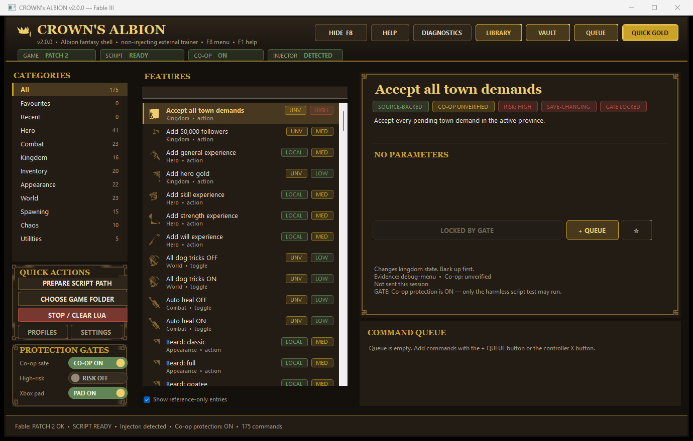

# CROWN'S ALBION — Fable III trainer

A native Windows trainer and command console for **Fable III (Patch 2, `Fable3.exe` 1.1.1.3)**,
recovered from the v1.6.1 baseline and rebuilt as a modular **v2.0** Menyoo-style shell.

CROWN'S ALBION is a **non-injecting external trainer**. It writes short, auditable Lua payloads to the
game's registered `MyScript01.lua` path and relies on the separately installed
**Improved Script Injector** DLC to execute them. It never patches, injects into, or replaces
`Fable3.exe`, `xlive.dll`, DLC, or save files.

> **Status:** the v2.0 shell, engine and data pipeline are complete and pass the offline regression
> suite. **No command has been verified live in Fable III yet.** Live gameplay and co-op testing
> still require a supervised session. See `docs/FEATURE_LEDGER.md` for per-command evidence.



## What v2.0 adds over the v1.6.1 baseline

- **Premium Albion theme** — leather/gold parchment palette, 9-slice frames, SVG icons
  (game-icons.net) rendered at runtime, custom buttons, toggles and sliders.
- **Modular source** — engine, UI shell, dialogs, theme, custom controls and models are separate
  files instead of one monolith.
- **Larger, source-backed catalogue** — 95 recovered commands plus 80 curated commands derived from
  the official Fable III debug-menu dump (175 total), and a 313-entry curated **item vault**
  (weapons, outfits, tattoos, makeup, clothing, hair, GFWL exclusives).
- **Honest evidence model** — every command is labelled `SOURCE-BACKED`, `v1.6.1 RECOVERED` or
  `COMMUNITY`, with risk and co-op badges, and the generated ledger classifies each one.
- **Visible safety gates** — the Execute button shows `LOCKED BY GATE` with the reason instead of
  failing only after a click.
- **Robust pulse** — a 5,000 ms window plus a persistent Lua sentinel, fixing the v1.6.1 case where
  the 1,900 ms auto-clear could expire before the injector's once-per-60-frames read.
- **Dialogs** — queue manager, research library, item vault, diagnostics, profiles and settings.
- **Offline regression suite** — data integrity, engine safety and 40 runtime engine checks.

## Requirements

- Windows 10/11, .NET Framework 4.x (the stock `csc.exe` is sufficient)
- Fable III Patch 2 (`Fable3.exe` SHA-256
  `AAC98798E77CA32282D663AF54FC185C3B5256B5317ED8568D7F12A0EF42DA42`)
- Improved Script Injector installed as `DLC\10_ScriptInjector`
- Script path prepared (`data\scripts\MyMod\MyScript01.lua` listed in `data\dir.manifest`)
- Optional: XLiveLessNess / Fable III Co-op v2.5.0-beta.1

## Build

```powershell
powershell -ExecutionPolicy Bypass -File tools\build.ps1
```

Output: `Exe, Menu\CROWNsAlbion.exe` plus the runtime JSON data files.

Regenerate the catalogue, item vault and ledger after editing `tools\generate-data.ps1`:

```powershell
powershell -ExecutionPolicy Bypass -File tools\generate-data.ps1
```

## Test (offline, no game required)

```cmd
tests\Run-All-Tests.cmd
```

- `tests\check-data.ps1` — catalogue/vault/ledger integrity (22 checks)
- `tests\check-source.ps1` — engine safety semantics (24 checks)
- `tests\Run-Engine-Tests.cmd` — runtime engine behaviour (40 checks)
- `tests\Capture-Dialogs.cmd` — renders each dialog to `docs\ui\` for visual QA

## Run

Run `Exe, Menu\CROWNsAlbion.exe`. Keep Fable III closed while preparing the script path.
The menu works with the game closed for inspection and settings.

Controls: **F8** show/hide · **F1** help · **Ctrl+F** search · **Ctrl+G** exact gold ·
**Ctrl+Q** queue review · **Enter** queue · **Ctrl+Enter** run queue.

Gamepad: **L3+R3** toggle · **D-pad** navigate · **A** select/exact amount · **B** back ·
**hold B** close · **Back/View** queue · **LB/RB** value · **hold Y** run selected ·
**hold Start** run queue.

## Safety

- **CO-OP PROTECTION is ON by default.** Gameplay writes are blocked; only the harmless
  connection test is allowed.
- High-risk/save-changing commands require an explicit opt-in.
- Script writes are backed up and hash-verified; another mod's `MyScript01.lua` is never overwritten.
- No save, DLC, executable or `xlive.dll` is modified by this project.
- Co-op compatibility of individual commands is **not** verified. Use disposable saves.

## Documentation

- `docs/RECOVERY_AUDIT.md` — what was found, hashes, environment and build provenance
- `docs/FEATURE_LEDGER.md` — every exposed command and its real evidence level
- `docs/QA.md` and `docs/QA_v1_6_1.md` — inherited test history
- `ATTRIBUTIONS.md` — third-party assets and licences

## Project layout

```
src/            C# source (WinForms, .NET Framework 4.x)
data/           catalogue, item vault, references, unlocker candidates
docs/           audits, ledger, QA, design, source research and screenshots
tests/          data, safety, engine and dialog-capture harnesses
tools/          build, data generation, diagnostics and recovery scripts
Assets/         supplied third-party assets (preserved, not redistributed)
Backups/        local recovery snapshots (git-ignored)
Exe, Menu/      runnable build output
```
